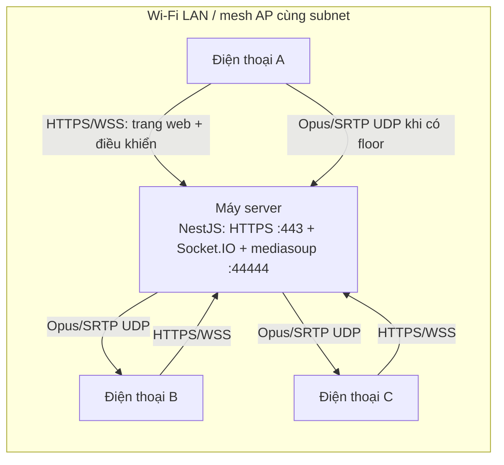
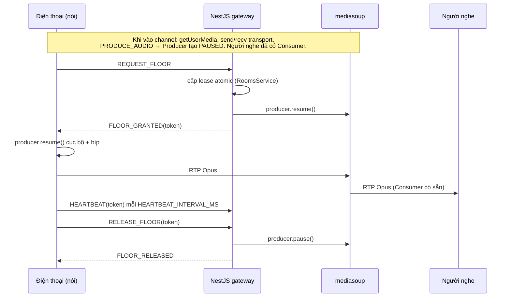

# MPC VoiceLink — Kiến trúc LAN PTT

## 1. Quyết định chính

Bộ đàm Push-to-Talk half-duplex trên trình duyệt điện thoại. Một máy trong LAN chạy **một tiến trình NestJS** làm tất cả: HTTPS, phục vụ giao diện web đã build, Socket.IO (channel, quyền nói) và mediasoup SFU (relay Opus). Điện thoại chỉ cần mở `https://<IP-server>`, chọn channel và giữ nút để nói.

| Lớp | Công nghệ | Vai trò |
|---|---|---|
| Web | React 19 + Vite 8 (`vite build --watch`) | UI mobile-first, mediasoup-client, Socket.IO client |
| Server | NestJS 11 + Express | HTTPS, static `apps/web/dist` + SPA fallback, `/health` |
| Signaling | Socket.IO (cùng origin) | Danh sách channel, vào/rời/đổi channel, floor lease, heartbeat, thiết lập WebRTC |
| Media | mediasoup 3 `WebRtcServer` | SFU Opus không transcode, một cổng UDP (TCP cùng cổng làm dự phòng) |
| Protocol | `packages/protocol` | Hằng số event + kiểu payload dùng chung |
| Monorepo | npm workspaces + Turborepo | `apps/server`, `apps/web`; `apps/web-p2p` độc lập |

## 2. Topology

Âm thanh không ra Internet. Socket.IO chỉ mang tín hiệu điều khiển.

## 3. Channel

- Khai báo trong `CHANNELS_FILE` (`[{ id, name, color, pin? }]`), tạo lúc server khởi động, không bao giờ bị xóa.
- `LIST_CHANNELS` trả danh sách (số người, có PIN, ai đang nói); server đẩy `CHANNELS_UPDATE` khi có thay đổi.
- `JOIN_CHANNEL { channelId, clientId, displayName, pin? }` trả `ROOM_STATE` hoặc lỗi `PIN_REQUIRED | PIN_INVALID | PIN_BLOCKED | CHANNEL_FULL | CHANNEL_NOT_FOUND`.
- Đổi channel trên cùng socket: transport giữ nguyên; server đóng Producer/Consumer của channel cũ, tạo Consumer cho channel mới; client tạo lại Producer.

### Chat

`SEND_CHAT { text }` (ack). Server phát `CHAT_MESSAGE` cho các thành viên của channel và gửi `CHAT_HISTORY` (50 tin gần nhất) khi có người vào. Tin chỉ nằm trong RAM; server kiểm tra người gửi đang ở channel, độ dài ≤ 500 ký tự, tối đa 5 tin/5 giây mỗi socket.

## 4. Luồng nói (độ trễ thấp)

- Bấm PTT chỉ tốn một round-trip Socket.IO cộng `producer.resume()`. Không còn getUserMedia, produce hay tạo Consumer lúc bấm.
- Server là nơi quyết định duy nhất. Client bật track sớm mà không có grant thì RTP vẫn bị drop vì Producer paused trên server.
- Pause/resume theo floor được tuần tự hóa cho từng channel. Resume chỉ chạy nếu client vẫn đang giữ floor.
- Hết lease, admin thu hồi (`AUDIO_CONTROL_CODE`) hay disconnect đều dẫn tới pause Producer trước rồi mới phát `FLOOR_RELEASED`.

## 5. Media

- Opus mono 48 kHz, ptime 20 ms, in-band FEC, DTX tắt, `OPUS_BITRATE` (mặc định 32 kbps), `MAX_OUTGOING_BITRATE`.
- Client: mic có EC/NS/AGC; mỗi Consumer phát qua một `<audio>` riêng (không qua Web Audio). Độ trễ phát chỉnh bằng `jitterBufferTarget`/`playoutDelayHint` (0–`TARGET_PLAYOUT_DELAY_MAX_MS`).
- `MEDIASOUP_ANNOUNCED_ADDRESS` = IP LAN; để trống hoặc IP LAN cũ không còn trên máy thì server tự dò.
- Phục hồi: ICE restart (`RESTART_ICE`) khi transport `disconnected/failed`; Socket.IO tự kết nối lại và vào lại channel cũ. Thành viên chỉ bị xóa bởi đúng socket sở hữu.
- Server không bao giờ ghi âm, lưu hay log audio.

## 6. HTTPS

Trình duyệt chỉ cho dùng micro trên origin HTTPS được tin cậy. `scripts/new-lan-tls.ps1` tạo CA + cert LAN; điện thoại cài CA một lần. Khi IP đổi, chạy lại với `-ReuseCa` để cấp cert mới mà không đổi CA.

## 7. Cấu hình (`apps/server/.env`)

- `HOST`, `PORT` (443), `TLS_CERT_PATH`, `TLS_KEY_PATH`, `WEB_DIST_PATH`, `CHANNELS_FILE`
- `MEDIASOUP_LISTEN_IP`, `MEDIASOUP_ANNOUNCED_ADDRESS`, `MEDIASOUP_PORT`, `MEDIASOUP_ENABLE_UDP/TCP`
- `MAX_MEMBERS_PER_ROOM`, `JOIN_MAX_FAILURES`, `JOIN_BLOCK_MS`, `FLOOR_LEASE_MS`, `HEARTBEAT_INTERVAL_MS`
- `OPUS_BITRATE`, `MAX_OUTGOING_BITRATE`, `TARGET_PLAYOUT_DELAY_*`, `AUDIO_CONTROL_CODE`

Cấu hình được đọc một lần lúc khởi động (`config/config.ts`).

## 8. Giới hạn

- Độ trễ thực tế còn phụ thuộc jitter buffer và driver âm thanh của từng điện thoại; server không ép được.
- Tầm xa phụ thuộc vùng phủ Wi-Fi: dùng nhiều AP cùng SSID/subnet, tắt client isolation.
- Một worker/router mediasoup cho toàn server. Đủ cho LAN vài chục máy; mở rộng thì làm một router mỗi channel.

`PROJECT_STATUS.md` là nguồn tiến độ chính thức.
