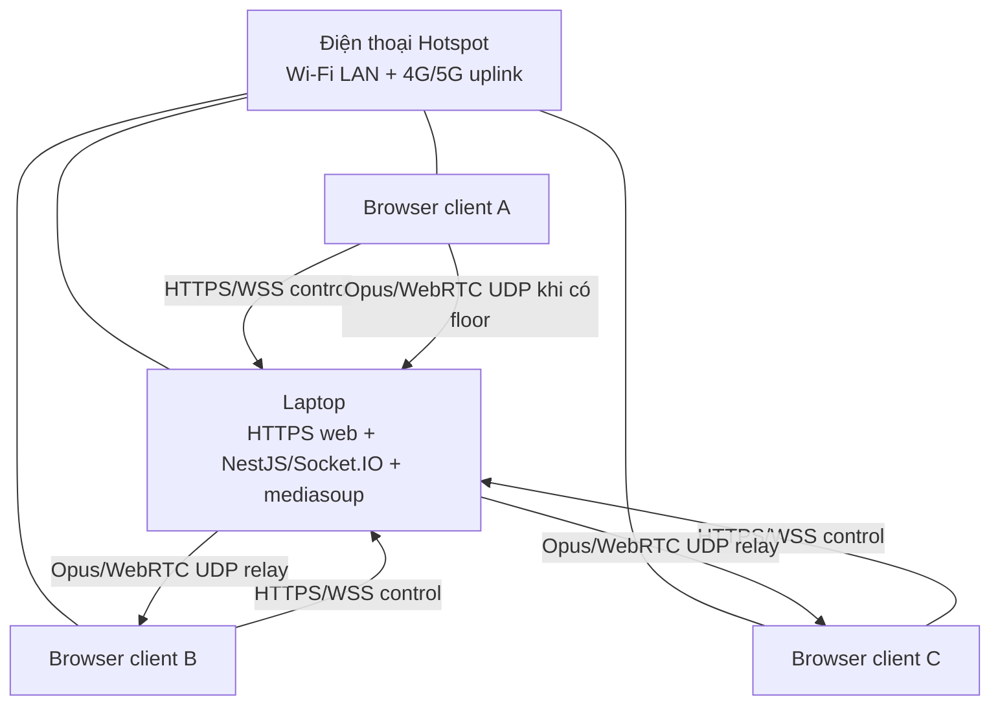
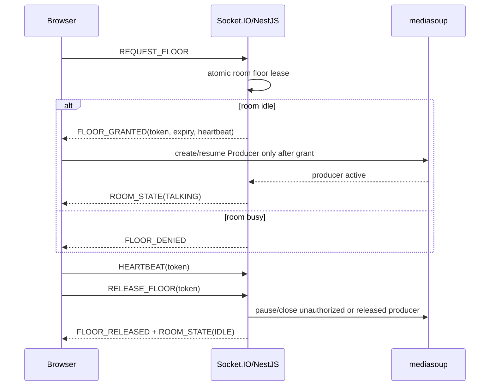

# MPC VoiceLink — Kiến trúc web LAN PTT

## 1. Quyết định chính

MPC VoiceLink là web app bộ đàm Push-to-Talk, half-duplex chạy qua browser. Laptop là server LAN duy nhất: NestJS/Socket.IO xử lý control plane và mediasoup SFU relay WebRTC audio. Điện thoại phát Hotspot chỉ cung cấp mạng, không phải media server.

Stack MVP:

| Lớp | Công nghệ | Vai trò |
|---|---|---|
| Web client | React + TypeScript + Vite | PTT UI, Socket.IO signaling, browser WebRTC/media |
| Server | NestJS + Socket.IO | Room, floor lease, heartbeat, auth MVP, signaling |
| Media | mediasoup | SFU relay Opus không transcoding |
| Protocol | packages/protocol | Event constants và payload types dùng chung |
| Monorepo | npm workspaces + Turborepo | Điều phối apps/web, apps/server, shared packages |
| Network | HTTPS/WSS + UDP WebRTC trong LAN | Browser secure context và media relay |

Không có Flutter/mobile native app trong kiến trúc mới.

## 2. Topology



4G/5G của Hotspot không phải đường audio mặc định. Audio chỉ ở LAN khi HTTPS/WSS và UDP WebRTC tới laptop đều là địa chỉ LAN, không chuyển qua cloud/TURN.

## 3. Browser security boundary

Browser microphone yêu cầu secure context. localhost tiện cho UI development, nhưng browser ở điện thoại truy cập IP LAN bằng HTTP không phải môi trường audio production hợp lệ.

- Laptop phải phục vụ origin HTTPS được client tin cậy trước getUserMedia.
- Khi web origin HTTPS, signaling dùng WSS.
- TLS certificate/key cấu hình bằng TLS_CERT_PATH và TLS_KEY_PATH; không commit key.
- Browser vẫn trao đổi WebRTC/DTLS-SRTP trực tiếp với mediasoup UDP trên laptop.
- Laptop là trust boundary của relay; DTLS-SRTP không làm laptop mù nội dung media.

## 4. Control plane và floor state



Room state:

- IDLE: room does not have a floor holder.
- REQUESTING: client-local pending request; server resolves it serially.
- TALKING: exactly one valid client/token holder.
- RELEASING: client/server is ending active producer and lease.

The server, not the browser UI, decides every floor transition. Expiry, tab close, socket disconnect, stale token and missing heartbeat release the floor.

## 5. Media lifecycle

Initial browser configuration is mono voice capture, Opus 48 kHz, 20 ms packetization and test bitrates 24/32/40 kbps. Standard WebRTC/mediasoup advertises Opus RTP as two-channel capability; client requests mono capture/stereo=0.

Mỗi client có send/receive WebRtcTransport riêng; server quản lý Producer, Consumer và quyền sở hữu cleanup. Một Producer chỉ hợp lệ khi floor lease tương ứng còn hiệu lực. Khi release/expiry:

1. Reject future media operations for the stale token.
2. Pause or close the active Producer.
3. Stop browser microphone track.
4. Pause/close Consumers as appropriate.
5. Close transports/resources on leave or disconnect.

No raw-audio Socket.IO, no server mixing/transcoding, no recordings, and no unbounded buffer.

## 6. Monorepo

```text
apps/
  web/                     React Vite browser UI
  server/                  NestJS + Socket.IO + mediasoup
packages/
  protocol/                JavaScript event constants + TypeScript contracts
turbo.json                 build/typecheck/dev task graph
```

Root commands:

    npm.cmd run dev
    npm.cmd run dev:web
    npm.cmd run dev:server
    npm.cmd run typecheck
    npm.cmd run build

Turborepo is required whenever adding a second app or shared package. Shared signaling contract belongs in packages/protocol; do not duplicate message strings or payload shapes.

## 7. Runtime configuration

apps/server/.env is local-only and ignored. apps/server/.env.example documents:

- HOST, PORT, CORS_ORIGINS
- TLS_CERT_PATH, TLS_KEY_PATH
- room join code and floor/heartbeat timings
- mediasoup listen/announced address and UDP range
- Opus relay policy/bitrate limits

The server can set relay policy, bitrate caps, lease duration and old-packet policy. It cannot force the same speaker-to-ear delay across browsers because jitter buffering, device drivers and OS audio scheduling are client-side factors.

## 8. LAN smoke test before media

1. Configure a real non-default join code and laptop LAN address.
2. Open the HTTPS web URL from two devices on the actual Hotspot.
3. Confirm WSS/Socket.IO, JOIN_ROOM and PTT floor contention.
4. Check UDP mediasoup ports and Windows Firewall.
5. Confirm microphone permission in browser on the HTTPS origin.
6. Only then implement browser mediasoup transports and audio.

If the Hotspot blocks laptop/client traffic or UDP, fix/replace network equipment. Do not silently route media through the Internet.

## 9. Current implementation boundary

Hiện đã có Turborepo, React PTT/audio UI, Socket.IO room/floor protocol, server floor lease, mediasoup router, WebRtcTransport UDP, Producer/Consumer lifecycle và Web Audio gain graph ở browser. Browser chỉ gọi `getUserMedia` sau `FLOOR_GRANTED`; server xác thực floor token trước khi nhận Producer và dọn Producer/Consumer khi floor kết thúc hoặc socket rời phòng.

Chưa nghiệm thu audio trên Hotspot/điện thoại thật, HTTPS/WSS certificate trust, Windows Firewall/UDP, bitrate benchmark và soak test. `PROJECT_STATUS.md` là nguồn tiến độ chính thức.
